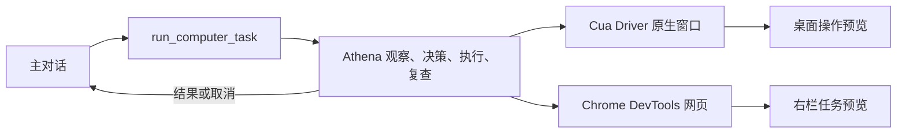

# AthenaAgent Computer Use 原型

原型用一个交互工具 `run_computer_task` 接管网页任务和桌面窗口操作。此前的 `run_browser_task` 和应用内的 Playwright 浏览代理已从分支移除。桌面输入通过 Cua Driver，内置浏览器通过 Chrome DevTools Protocol（CDP）。Athena 负责目标选择、模型决策、动作确认、取消和结果回传。

## Cua Driver 与 .NET 接入

Cua Driver 是 trycua/cua 的原生桌面操作驱动。它封装各平台的窗口枚举、截图、无障碍树和输入能力。上游提供 Python、TypeScript 和 MCP 等使用方式，也发布可直接集成的 C ABI。原型固定使用 **0.58.1**，以发布版的 `cua_driver_abi.h` 为接口依据。不同操作系统、窗口系统和目标应用的输入与叠层能力见上游平台说明。[0.58.1 发布页](https://github.com/trycua/cua/releases/tag/cua-driver-rs-v0.58.1) · [固定版本 C ABI](https://github.com/trycua/cua/blob/cua-driver-rs-v0.58.1/libs/cua-driver/rust/include/cua_driver_abi.h) · [平台支持](https://cua.ai/docs/cua-driver/concepts/platform-support)

Athena 在应用进程中使用 `NativeLibrary` 加载动态库，绑定 `cua_driver_*_v1` 导出函数。`CuaDriverNative` 将异步回调转换成 .NET 任务，传递取消信号，释放驱动返回的缓冲区和操作句柄。桌面任务按用户选中的窗口开启会话，每轮读取截图和控件树。带控件令牌的操作走语义输入，像素点击带当前截图的 `capture_id`。桌面预览由 Athena 在截图上绘制 AI 光标。[CuaDriverNative.cs](../Services/ComputerUse/CuaDriverNative.cs) · [ComputerUseService.cs](../Services/ComputerUse/ComputerUseService.cs) · [ComputerUsePreview.cs](../Controls/ComputerUsePreview.cs)

## 原型设计



- **模型与执行**。桌面模型使用「图片识别」角色，未配置时使用主对话模型。网页规划器使用配置中的官方 DeepSeek `deepseek-flash`，每轮把截图、当前网址、可见文字和带坐标的控件交给模型。执行器按当前观察解析控件编号或像素，在网页变化时重新观察。动作结果和前页核对过的信息供下一轮决策使用。规划器要求模型先观察到目标结果，再报告完成。[ComputerUsePlanner.cs](../Services/ComputerUse/ComputerUsePlanner.cs) · [BrowserComputerUseSession.cs](../Services/ComputerUse/BrowserComputerUseSession.cs)
- **浏览器与右栏**。Athena 按需启动一个无独立窗口的 Chrome 进程。「浏览」与「任务」使用不同的临时浏览器上下文，浏览时登录的状态与自动任务隔离。聊天网页链接默认打开「浏览」页，右键可交给系统浏览器。任务从主对话启动，右栏自动展开「任务」页，显示网址、页面和光标。右栏用单独的 CDP 连接取帧。关闭或收起右栏只停预览，任务视口保持 **800 × 720**，右栏缩放只改变显示比例。普通浏览的视口随面板尺寸变化。[EmbeddedBrowser.cs](../Services/ComputerUse/EmbeddedBrowser.cs) · [EmbeddedBrowserView.axaml.cs](../Views/EmbeddedBrowserView.axaml.cs) · [CDP Target](https://chromedevtools.github.io/devtools-protocol/tot/Target/)
- **地址栏**。主模型可用工具参数 `startingUrl` 指定起始页。省略时，工具优先使用选中的桌面窗口，其次使用内置浏览器已知的页面地址。网页规划器把“点击地址栏、输入网址并回车”转换为 `navigate` 动作，由 CDP 的 `Page.navigate` 执行，然后观察目的页。起始网址和导航动作均接受无内嵌凭据的 HTTP(S) 绝对地址。[ComputerUseFunctions.cs](../Services/Functions/ComputerUseFunctions.cs) · [CDP Page](https://chromedevtools.github.io/devtools-protocol/tot/Page/)
- **结果与停止**。任务按主对话工具调用串行执行，经过原有审批流程。原型在单次任务运行 3 分钟后触发取消，桌面任务最多执行 16 次输入动作。主对话等待工具结果并继续生成回复。点击聊天输入框右侧的「停止」会取消同一轮对话及任务，并为已发出的工具调用保留中断结果。关闭右栏不影响此链路。[OpenAIChatService.cs](../Services/OpenAIChatService.cs) · [ToolExecutionContext.cs](../Services/SubAgents/ToolExecutionContext.cs)

## 使用与复现

### 桌面操作

桌面演示在 Linux x64 图形会话运行。准备 .NET 10 SDK、Bash、`curl`、`unzip` 和 `sha256sum` 后，从仓库根目录执行脚本。

```bash
bash Scripts/run-computer-use-demo.sh
```

脚本从固定版本的 wheel 提取 `libcua_driver_sdk.so`，首次下载时校验 SHA-256。脚本会在需要时构建本地 PTC 包源。演示打开操作预览和独立表单，通过 Cua Driver 输入中文、点击确认，再以目标表单的回报验证结果。日志中的 `Computer Use demo verified: true` 表示表单确认了文本。[演示脚本](../Scripts/run-computer-use-demo.sh) · [0.58.1 wheel](https://pypi.org/project/cua-driver/0.58.1/#files)

运行 `bash Scripts/run-computer-use-demo.sh --app` 启动完整应用。打开左侧「桌面操作」，选择目标窗口，然后在主对话描述要执行的动作和完成条件。已有 SDK 时可用环境变量 `ATHENA_CUA_DRIVER_LIBRARY` 指定动态库完整路径。常规启动也会在应用目录查找对应平台的默认库文件 `cua_driver_sdk.dll`、`libcua_driver_sdk.dylib` 或 `libcua_driver_sdk.so`。

### 内置浏览器与网页任务

安装本机 Chrome 或 Chromium。普通浏览可点击聊天中的网页链接，或通过对话标题栏的地球图标打开浏览器。要执行网页任务，在「供应商模型」中配置 `https://api.deepseek.com` 的官方 API 密钥，再从主对话发起。下面这条指令可用于验证跨站导航。

> 用 Computer Use 从 https://example.org/ 开始。点击地址栏，输入 https://www.iana.org/help/example-domains 并回车。打开后读取网页标题，在对话里告诉我。

「任务」页会显示实际打开的网址与网页。要结束正在运行的任务，点击聊天输入框右侧的「停止」。

### 回归测试

从仓库根目录运行以下命令。第一条会启动真实 Chrome，网页由本地测试表单提供，主模型与网页规划器使用固定响应。第二条执行完整的 Avalonia 无头测试。

```bash
ATHENA_HEADLESS_ONLY=computer-use ATHENA_BROWSER_SMOKE=1 \
  bash Scripts/run-headless-tests.sh /tmp/athena-computer-use.png
bash Scripts/run-headless-tests.sh /tmp/athena-main-window.png
```

## 验证记录

本轮提交前验证环境为 Fedora Linux 45 x64、.NET SDK 10.0.113、Chrome 156.0.8078.79。Cua Driver 桌面演示记录使用 0.58.1。同一测试环境的 X11 虚拟桌面叠层试验与原型的应用内预览分别验收。

| 项目 | 实测结果 |
| --- | --- |
| Cua Driver 桌面表单，2026-11-25 | 驱动找到独立表单，录入中文并点击确认。目标窗口回报内容与预期一致。 |
| 系统级光标叠层，2026-11-25 | 隔离 X11 桌面截图捕捉到上游 Cua Driver 光标。GNOME Wayland 的系统级叠层未验收。当前桌面产品界面展示的是 Athena 窗口预览中的光标。 |
| 窗口缩窄与多页任务，早期浏览器原型 | 英文 Wikipedia 的测试将实际视口从 1176 × 786 缩到 546 × 601，页面重排后仍完成了站内搜索并核对 Ada Lovelace 条目。另一次长任务依次访问 Ada Lovelace、Charles Babbage、Difference engine 与 Analytical engine，约 100 秒；早期尝试也有中途结束的记录。 |
| 12306 未登录查询，早期浏览器原型 | 测试脚本查询 2026-11-25 广州至苏州，核对了登录入口、日期和查询请求。当时页面显示 0 条直达结果。采集后约 186 毫秒退出该次测试的浏览器会话，并核查临时配置已删除。 |
| 官方 DeepSeek Flash 与真实网页 | 从 Example Domain 页面开始，执行地址栏导航，浏览器确实到达 IANA。工具返回成功，主模型接着回复了目的页标题 “Example Domains”。[IANA 测试目的页](https://www.iana.org/help/example-domains) |
| 当前实现的浏览器回归 | 验证聊天链接路由、网页链接和前进后退、拒绝非网页导航、右栏缩窄与关闭。关掉右栏后真实 Chrome 仍提交了表单，下一次主模型请求带有匹配的工具结果。点击聊天停止按钮能取消正在等待的网页决策，主对话留下配对的中断结果。 |
| 提交前复验，2026-11-26 | 浏览器专项测试与完整 Avalonia 无头测试通过。构建为 0 警告、0 错误。 |

本记录覆盖 Linux 上的原型操作。Windows 与 macOS 的 Athena 端到端流程，以及仅凭截图定位控件的成功率，尚未验收。
