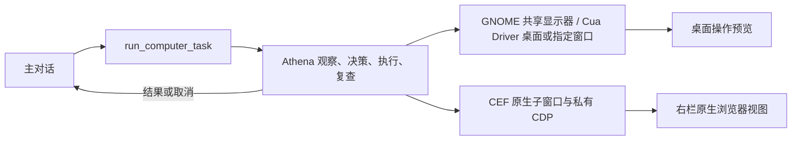

# AthenaAgent Computer Use 原型

主对话使用 `run_computer_task` 执行当前桌面或内置网页任务。桌面默认允许跨应用操作。GNOME Wayland 通过桌面门户获取共享显示器和输入权限，macOS、Windows 与 X11 使用随包的 Cua Driver，内置浏览器通过 CDP。

## Cua Driver 与 .NET 接入

Cua Driver 是 trycua/cua 的原生桌面操作驱动。它封装各平台的窗口枚举、截图、无障碍树和输入能力。上游提供 Python、TypeScript 和 MCP 等使用方式，也发布可直接集成的 C ABI。原型固定使用 **0.58.1**，以发布版的 `cua_driver_abi.h` 为接口依据。不同操作系统、窗口系统和目标应用的输入与叠层能力见上游平台说明。[0.58.1 发布页](https://github.com/trycua/cua/releases/tag/cua-driver-rs-v0.58.1) · [固定版本 C ABI](https://github.com/trycua/cua/blob/cua-driver-rs-v0.58.1/libs/cua-driver/rust/include/cua_driver_abi.h) · [平台支持](https://cua.ai/docs/cua-driver/concepts/platform-support)

Athena 以 C ABI 调用固定版本的 Cua Driver。构建时校验发行 wheel 的 SHA-256，提取目标架构的动态库与许可证，复制到构建和发布目录。macOS、Windows 与 X11 使用主显示器画面及前台输入。用户明确选择单个窗口后，每一轮观察与输入才绑定到对应进程和窗口。[驱动接入](../Services/ComputerUse/NativeDesktopSession.cs) · [构建脚本](../Scripts/stage-cua-driver.py)

## 原型设计



- **模型与执行**。在「应用设置 → 内置浏览器 → 网页任务」或「供应商与模型 → 业务模型分工」选择和测试 Computer Use 视觉模型。两处编辑同一角色，桌面和网页共用。每轮把当前画面和可见控件交给模型，网页观察还带有当前地址。能力未知时用合成图验证模型能读图并返回动作。
- **动作输出**。供应商支持结构化输出时，网页规划器用 JSON Schema 指定动作和字段类型。解析时按当前动作检查字段，控件编号 `"[7]"` 和坐标 `"24.5"` 等可明确还原的写法可以使用。控件必须来自当前观察，坐标必须处于截图内。正文为空、输出截断或动作必需字段有误时，按「无效动作重试次数」使用同一张截图再请求模型，提示需要改正的字段并提高输出额度。每次决策可重试 0–3 次，默认 1 次。官方 DeepSeek Responses 重试时还会关闭推理。达到重试上限时，工具将具体原因返回主对话。
- **网页文字输入**。`type_text` 先点中可编辑控件，再通过 Chrome DevTools 逐字发送带文字的按下与释放事件。短文本在右栏有逐字出现的间隔。由多个 Unicode 码点组合成的字符及换行等控制字符按原样插入。网页出现自动补全候选时，规划器会先观察并选择匹配项，再移动焦点。[Chrome DevTools Input](https://github.com/ChromeDevTools/devtools-protocol/blob/master/pdl/domains/Input.pdl)
- **网页横向滚动**。每轮截图覆盖当前视口。整页存在横向溢出时，观察会提供还可以滚动的方向。模型用 `scroll` 的 `left` 或 `right` 横向滚动，可指定截图中表格或轮播内的坐标。每次横移取滚动区域可见宽度的约 80%，下一次截图保留一段重叠，便于连续阅读和定位。滚动后按新截图上的坐标操作。
- **内置 CEF 原生浏览器与右栏**。发布包包含固定版本的 CEF Minimal（`158.0.6+g23f1736+chromium-158.0.8127.89`）与极薄自研原生 C ABI 桥接层（[athena_cef_abi.h](../Native/CefBridge/athena_cef_abi.h)）及轻量原生子进程（`athena_cef_helper`）。主窗口通过 Avalonia `NativeControlHost`（[CefBrowserHostControl.cs](../Controls/CefBrowserHostControl.cs)）以 `CEF_RUNTIME_STYLE_ALLOY` 真原生子视图嵌入网页（macOS `NSView`、Windows `HWND`、Linux X11 `XID`），支持原生高刷滚动、触控板惯性回弹、指针样式与输入法；macOS 下 4 个 Helper `.app` 均配置 `LSUIElement=true` 与 `LSBackgroundOnly=true`，Dock 仅保留唯一 Athena 图标。CDP 通过 CEF 纯内存通道 `send_dev_tools_message` 执行，不开启 TCP 调试端口。「浏览」和「任务」有各自的页签，共用 Athena 的持久 Cookie 和站点存储，并保留页签排序、静音与批量关闭领域能力。人工输入提示条与登录/权限/JS 对话框置于画布上方独立非重叠行以避免原生子窗口 Airspace 遮挡；任务运行期间通过点击穿透透明浮窗（[DesktopCursorDisplay.cs](../Controls/DesktopCursorDisplay.cs) 中的 `BrowserCursorOverlay`）在网页区域上方绘制 Athena 光标，不会污染 `Page.captureScreenshot` 观察截图。无头测试环境下自动以 `SetAsWindowless` 运行同一真 Chromium 158 回归。关闭或收起右栏会停放原生子视图并保持后台任务继续运行。
- **目标选择**。仅传 `instruction` 即可操作当前桌面。显式传 `target="desktop"` 始终控制整块显示器。若用户在预览中限定了窗口，省略目标时遵循该选择。`startingUrl` 启动 HTTP(S) 网页任务，`target="browser"` 可沿用右栏当前页面。[工具入口](../Services/Functions/ComputerUseFunctions.cs)
- **结果与停止**。任务通过主对话工具调用进入原有审批流程。网页任务开始时读取时限和重试次数，最长运行时间可设为 1–60 分钟，默认 3 分钟。用户直接滚动、点击、输入或切换任务标签时，任务继续运行，右栏短暂提醒用户操作可能影响结果。手动输入和模型动作依次送给浏览器。手动操作使未执行的模型决定过期，Agent 自动重新观察。用户点「接管」时显式暂停，也可以由 Agent 交回控制权。暂停期间停止发送新观察并暂停计时。点击「继续」重新观察，点击聊天「停止」结束任务。
- **网站权限**。自动执行期间出现的新权限请求立即收到拒绝结果，右栏提示用户可在接管后重试。已有站点授权仍由浏览器的权限检查处理。手动浏览或暂停时，新请求由用户确认。登录、文件选择和需要回答的网页对话继续交给用户。

## 使用与复现

### 桌面操作

GNOME Wayland 使用系统的 RemoteDesktop 和 ScreenCast 门户，在同一会话取得键鼠与显示器流。PipeWire、GStreamer 的 pipewire、videoconvert、videoscale、videorate、jpegenc 和 appsink 组件需可用。在源代码环境运行单窗口表单演示可执行以下命令。

```bash
bash Scripts/run-computer-use-demo.sh
```

演示在独立进程的表单中输入中文并点击确认，通过目标进程回报校验结果。日志记录 `Computer Use demo verified: true` 表示表单确认成功。[演示脚本](../Scripts/run-computer-use-demo.sh)

正常启动或执行 `dotnet run --project Athena.UI.csproj` 后，直接在主对话下达跨应用任务。在「桌面操作」可以预览并停止输入。系统拒绝共享、停止共享、工具取消和任务结束都会关闭桌面会话。[GNOME 接入](../Services/ComputerUse/PortalDesktopSession.cs) · [XDG RemoteDesktop](https://flatpak.github.io/xdg-desktop-portal/docs/doc-org.freedesktop.portal.RemoteDesktop.html)

当前桌面任务在系统前台应用上显示带「Athena」标签的青色箭头。桌面预览和网页任务共用箭头、移动动画、点击波纹和输入提示的绘制逻辑。独立光标窗口允许点击穿透，键盘焦点仍在被操作的应用。Athena 取桌面观察帧时临时隐藏该窗口，任务完成、取消或失败后关闭它。桌面任务的实际键鼠操作由系统前台会话接收。[光标绘制](../Controls/ComputerUseCursorDrawing.cs) · [桌面显示](../Controls/DesktopCursorDisplay.cs)

GNOME 的 RemoteDesktop v2 支持记住选择。首次共享显示器时保留系统对话框中的记住选项，之后 Athena 在每个新任务开始时向系统恢复此前批准的显示器和键鼠权限。任务之间屏幕共享处于关闭状态。恢复凭据按用户保存在本机状态目录，每次使用后保存系统返回的新凭据。用户撤销授权、显示器无法恢复或使用旧版门户时，系统会再次询问。[门户会话持久化](https://flatpak.github.io/xdg-desktop-portal/docs/doc-org.freedesktop.portal.RemoteDesktop.html#session-persistence)

在 Wayland 桌面会话中，`type_text` 若带有屏幕坐标会先点击目标输入框并等待焦点稳定，随后通过 `org.freedesktop.portal.Clipboard` 写入 UTF-8 剪贴板并发送 `Ctrl+V` 粘贴（支持暂存并恢复原有纯文本剪贴板），绕过 IBus/Rime 等输入法组合并兼容原生 Wayland 与 XWayland 应用；若没有控件读取剪贴板，会明确回报给规划器。不支持剪贴板门户的旧环境继续使用门户键位事件。快捷键和切换窗口均通过门户发送。[剪贴板粘贴实现](../Services/ComputerUse/PortalClipboard.cs) · [GNOME 接入](../Services/ComputerUse/PortalDesktopSession.cs)

### 内置浏览器与网页任务

正式包自带浏览器运行时。普通浏览可点击聊天链接或打开右栏地球入口；首次打开面板时即自动选中一个空白新标签页（若已配置起始页则直接加载该主页，支持不显式输入 `https://` 直接输入域名或本地地址）。右侧浏览器采用统一横向并列标签栏（普通浏览与网页任务页签以专属图标区分），支持拖拽排序、右键菜单（单独关闭 / 关闭其他 / 关闭右侧 / 关闭全部 / 静音与取消静音 / 在外部浏览器打开 / 复制 URL）、窄宽溢出时右缘 `OpacityMask` 渐变虚化与滚轮/触控板横向滑动；标签栏右侧常驻「进入/退出完整视图」与关闭按钮，也支持在分屏下将右分割栏越过 540px 主对话最小宽度继续拖动 ≥ 56 DIP 触发完整视图。完整视图占据「中间 + 右侧」两列并保留左侧会话列表栏，顶部最左侧固定不可关闭的「主对话」标签与 `>` 分屏恢复按钮（点击「主对话」标签暂停 CEF 预览并将主对话扩展至全宽，点击任意网页标签或 `+` 切回全宽浏览器，点击 `>` 或退出按钮恢复分屏；当最后一个网页标签页被关闭时，分屏下自动关闭浏览器面板切回工作台/日志，完整视图下自动退出完整视图并恢复分屏）。模型角色中的图标可测试连接与能力，绿色数字是完整测试耗时。起始页、下载目录与资料清理由「应用设置 → 内置浏览器」管理。浏览资料保存在操作系统的 AthenaAgent 用户数据目录下，持久 Cookie 的过期与注销遵循网站规则。下面这条指令可用于验证跨站导航。

> 用 Computer Use 从 https://example.org/ 开始。点击地址栏，输入 https://www.iana.org/help/example-domains 并回车。打开后读取网页标题，在对话里告诉我。

网页任务页签带专属图标徽章并显示实际打开的网址与网页。要结束正在运行的任务，点击聊天输入框右侧的「停止」。

准备脚本（[stage-browser-runtime.py](../Scripts/stage-browser-runtime.py)）按目标 RID 读取 [BrowserRuntime.json](../Services/ComputerUse/BrowserRuntime.json) 中锁定的 CEF Minimal 版本与哈希，完成下载校验、零 CMake 原生编译（macOS `xcrun clang++`、Linux `clang++`/`g++`、Windows MSVC `cl.exe`）与精简打包，输出至 `<output>/BrowserRuntime/`。macOS 发布包在 `release.sh` 组装 `Athena.app` 时将 `Chromium Embedded Framework.framework` 与 4 个 `Athena Helper*.app` 规范放入 `Contents/Frameworks/` 并由内而外执行 ad-hoc 签名。浏览资料保存在操作系统的独立用户数据目录下，版本升级替换运行时后仍沿用原资料。

`dotnet build -c Release` 会自动准备对应平台的 CEF 运行时与桥接库；准备失败会使 Release 构建报错。源码调试使用 `dotnet run --project Athena.UI.csproj` 或手动执行准备脚本：

```bash
python3 Scripts/stage-browser-runtime.py osx-arm64 bin/Debug/net10.0
```

> 历史注记：早期版本曾采用 Electron 离屏渲染及 macOS IOSurface / Linux DMA-BUF 共享纹理原型，现已全量移除并由原生 CEF Windowed 架构取代。

### 回归测试

从仓库根目录构建 Release，再让浏览器专项测试使用该构建携带的 CEF 运行时：

```bash
dotnet build -c Release
ATHENA_HEADLESS_ONLY=computer-use ATHENA_BROWSER_SMOKE=1 \
  ATHENA_BROWSER_RUNTIME_DIRECTORY="$PWD/bin/Release/net10.0/BrowserRuntime" \
  bash Scripts/run-headless-tests.sh /tmp/athena-computer-use.png
bash Scripts/run-headless-tests.sh /tmp/athena-main-window.png
```

## 验证记录

本轮提交前验证环境为 Fedora Linux 45 x64、.NET SDK 10.0.113、Chrome 156.0.8078.79。Cua Driver 桌面演示记录使用 0.58.1。同一测试环境的 X11 虚拟桌面叠层试验与原型的应用内预览分别验收。

| 项目 | 实测结果 |
| --- | --- |
| GNOME Wayland 跨应用与授权恢复，2026-11-27 | Fedora 45、内屏 3072 × 1920、150% 缩放。主工具 `run_computer_task` 只接收任务说明，MiniMax-M3.1-Flash 点击 GNOME 计算器等号读得 845，再点击文本编辑器，在第二行输入 `GNOME result = 845` 并用 Ctrl+S 保存。独立读取文件确认标题与结果行均正确。关闭共享后新建连接，654 毫秒重新取得 1440 × 900 的授权显示器帧，系统直接复用首次选择。 |
| GNOME 桌面虚拟光标，2026-11-27 | 在本机 GNOME Wayland、150% 缩放和原生 GTK 文本窗口上，通过独立显示器画面验证了 Athena 箭头、点击波纹与输入标签。窗口收到实际点击和指定文字，并持续持有焦点。两张供规划器使用的观察图和任务结束后的桌面局部均无光标或标签。 |
| 桌面光标清理，2026-11-27 | 在只有一块显示器、未指定主屏的隔离 X11 会话中，分别停止任务和触发规划错误。两次都先观察到光标窗口出现，任务返回后确认光标窗口已消失。 |
| GNOME 指针实际落点，2026-11-27 | 对共享屏幕右部和右下部的两个位置做只移动指针的实测。在 1440 × 900 的观察图上，请求 (1010, 258) 和 (1260, 675)，独立读回 (1009.69, 257.70) 和 (1260, 675)。整条输入链路的两个落点误差均小于一个观察图像素。 |
| 桌面坐标定位，2026-11-27 | 在同一张 1440 × 900 的隔离桌面截图上，让 MiniMax-M3.1-Flash 分别定位 GNOME 计算器的数字 7 和等号，以及 GNOME 文本编辑器的主菜单和正文。每个目标独立请求两次，8 个坐标均在预先确定的控件边界内。34 × 35 像素的主菜单按钮两次落点距中心约 3–4 像素。此项只衡量指定控件的静态定位。 |
| Cua Driver 桌面表单，2026-11-25 | 驱动找到独立表单，录入中文并点击确认。目标窗口回报内容与预期一致。 |
| 系统级光标叠层，2026-11-25 | 隔离 X11 桌面截图捕捉到上游 Cua Driver 光标。GNOME Wayland 的系统级叠层未验收。当时的 Athena 只在应用内预览绘制光标。 |
| 窗口缩窄与多页任务，早期浏览器原型 | 英文 Wikipedia 的测试将实际视口从 1176 × 786 缩到 546 × 601，页面重排后仍完成了站内搜索并核对 Ada Lovelace 条目。另一次长任务依次访问 Ada Lovelace、Charles Babbage、Difference engine 与 Analytical engine，约 100 秒；早期尝试也有中途结束的记录。 |
| 12306 未登录查询，早期浏览器原型 | 测试脚本查询 2026-11-25 广州至苏州，核对了登录入口、日期和查询请求。当时页面显示 0 条直达结果。采集后约 186 毫秒退出该次测试的浏览器会话，并核查临时配置已删除。 |
| 官方 DeepSeek Flash 与真实网页 | 从 Example Domain 页面开始，执行地址栏导航，浏览器确实到达 IANA。工具返回成功，主模型接着回复了目的页标题 “Example Domains”。[IANA 测试目的页](https://www.iana.org/help/example-domains) |
| 早期原型的浏览器回归 | 验证聊天链接路由、网页链接和前进后退、拒绝非网页导航。窗口宽高变化后，「浏览」和「任务」两页都填满页面区域。任务视口从 468 × 685 调整为 358 × 925，旧坐标被作废，模型的新截图包含下方提交按钮。关掉右栏后真实 Chrome 仍提交了表单，下一次主模型请求带有匹配的工具结果。点击聊天停止按钮能取消正在等待的网页决策，主对话留下配对的中断结果。 |
| 网页动作解析，2026-11-26 | 专项测试注入了输出截断、空正文及非数字 `element`，三次均在同一观察上各重试一次并恢复，拆成多个文本片段的动作也能读取。另用真实 Chrome 和官方 `deepseek-flash` 在 358 × 925 和 468 × 685 两种视口填表和提交，两轮都读回了与服务端一致的回执。在 12306 公开查询页只读识别控件时，模型有一次返回不完整的动作，重试后识别成功。 |
| 网页自动补全，2026-11-26 | 旧的文本插入在 12306 输入「苏州」时未生成候选或站点码。改用逐字键盘事件后，出现「苏州北」「苏州」「苏州南」等候选。官方 `deepseek-flash` 在 468 × 850 视口选中「苏州」并转移焦点，页面仍保留站点码 `SZH`。本地 Chrome 回归覆盖逐字事件、候选选择、失焦保留和表单提交。 |
| 随包运行时和共享资料，2026-11-26 | Linux x64 从发布包提取 Electron 45.5.0，并在仅有回环网络、系统 Chrome 不可见的环境验收本地站点。浏览与任务共享同一登录，Cookie、站点存储和历史跨运行时重启及安装位置变更保留。验证上传、下载、对话框、权限与接管后重新观察。官方 DeepSeek 在 12306 完成真实视觉测试和选站，失焦后保留 `SZH`。 |
| 提交前复验，2026-11-26 | 浏览器专项测试与完整 Avalonia 无头测试通过。构建为 0 警告、0 错误。 |
| 网页原生弹层，2026-11-26 | 在真实 MDN 中文首页点击搜索并输入 `Array.prototype.map()`。搜索候选正常出现，Avalonia 预览截图在输入点显示 Athena 光标。随包运行时回归覆盖弹层上的光标合成，以及开放 Shadow DOM 内的输入焦点。 |
| 动作字段与任务页恢复，2026-11-26 | 模拟供应商验证了未使用字段的类型错误、字符串坐标和布尔值，以及非法控件编号和不完整坐标的拒绝。随包 Electron 45.5.0 的实际视口被强制改动后，「任务」页在原页签显示新帧，任务重新观察并完成提交。换模型后的同一会话第二次任务将截图发给了新模型。另用官方 `deepseek-flash` 在 358 × 850 的本地测试页填写并提交中文，页面回显和工具结果均已验证。 |
| 网页任务设置 | 在设置界面修改视觉模型、运行时限和重试次数后重载配置，验证了两处共用的模型角色与保存值。随包 Electron 专项验证了同一观察重试两次、接管暂停计时，以及继续后到时返回明确的超时结果。 |
| 右栏清晰度和帧率，2026-11-26 | Fedora 桌面在 2× 下对同一 466 × 509 CSS 像素动画页采样实际窗口。旧版约 7.4–7.8 FPS。修改后首次短测约 23.6 FPS，两次 5 秒复测均为约 59.5 FPS。原始帧从 466 × 509 提高到 932 × 1018。随包 Electron 专项核对了物理像素位置、人工及模型点击、网页弹层上的光标、缩放后重新观察，以及收起面板继续执行并回传结果。 |

已在 Fedora 交叉构建 Windows x64 和 macOS arm64，并核验随包的 PE、Mach-O 原生驱动。Windows 与 macOS 的桌面输入仍待对应系统实机验收。
