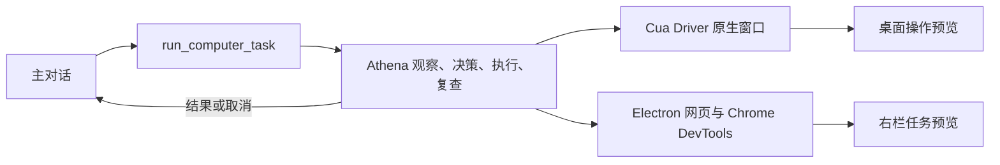

# AthenaAgent Computer Use 原型

原型用一个交互工具 `run_computer_task` 接管网页任务和桌面窗口操作。此前的 `run_browser_task` 和应用内的 Playwright 浏览代理已从分支移除。桌面输入通过 Cua Driver，内置浏览器通过 Chrome DevTools Protocol（CDP）。Athena 负责目标选择、模型决策、动作确认、取消和结果回传。

## Cua Driver 与 .NET 接入

Cua Driver 是 trycua/cua 的原生桌面操作驱动。它封装各平台的窗口枚举、截图、无障碍树和输入能力。上游提供 Python、TypeScript 和 MCP 等使用方式，也发布可直接集成的 C ABI。原型固定使用 **0.58.1**，以发布版的 `cua_driver_abi.h` 为接口依据。不同操作系统、窗口系统和目标应用的输入与叠层能力见上游平台说明。[0.58.1 发布页](https://github.com/trycua/cua/releases/tag/cua-driver-rs-v0.58.1) · [固定版本 C ABI](https://github.com/trycua/cua/blob/cua-driver-rs-v0.58.1/libs/cua-driver/rust/include/cua_driver_abi.h) · [平台支持](https://cua.ai/docs/cua-driver/concepts/platform-support)

Athena 在应用进程中使用 `NativeLibrary` 加载动态库，绑定 `cua_driver_*_v1` 导出函数。`CuaDriverNative` 将异步回调转换成 .NET 任务，传递取消信号，释放驱动返回的缓冲区和操作句柄。桌面任务按用户选中的窗口开启会话，每轮读取截图和控件树。带控件令牌的操作走语义输入，像素点击带当前截图的 `capture_id`。桌面预览由 Athena 在截图上绘制 AI 光标。[CuaDriverNative.cs](../Services/ComputerUse/CuaDriverNative.cs) · [ComputerUseService.cs](../Services/ComputerUse/ComputerUseService.cs) · [ComputerUsePreview.cs](../Controls/ComputerUsePreview.cs)

## 原型设计



- **模型与执行**。在「应用设置 → 内置浏览器 → 网页任务」或「供应商与模型 → 业务模型分工」选择和测试 Computer Use 视觉模型。两处编辑同一角色，桌面和网页共用。每轮把当前画面和可见控件交给模型，网页观察还带有当前地址。能力未知时用合成图验证模型能读图并返回动作。
- **动作输出**。供应商支持结构化输出时，网页规划器用 JSON Schema 指定动作和字段类型。解析时按当前动作检查字段，控件编号 `"[7]"` 和坐标 `"24.5"` 等可明确还原的写法可以使用。控件必须来自当前观察，坐标必须处于截图内。正文为空、输出截断或动作必需字段有误时，按「无效动作重试次数」使用同一张截图再请求模型，提示需要改正的字段并提高输出额度。每次决策可重试 0–3 次，默认 1 次。官方 DeepSeek Responses 重试时还会关闭推理。达到重试上限时，工具将具体原因返回主对话。
- **网页文字输入**。`type_text` 先点中可编辑控件，再通过 Chrome DevTools 逐字发送带文字的按下与释放事件。短文本在右栏有逐字出现的间隔。由多个 Unicode 码点组合成的字符及换行等控制字符按原样插入。网页出现自动补全候选时，规划器会先观察并选择匹配项，再移动焦点。[Chrome DevTools Input](https://github.com/ChromeDevTools/devtools-protocol/blob/master/pdl/domains/Input.pdl)
- **网页横向滚动**。每轮截图覆盖当前视口。整页存在横向溢出时，观察会提供还可以滚动的方向。模型用 `scroll` 的 `left` 或 `right` 横向滚动，可指定截图中表格或轮播内的坐标。每次横移取滚动区域可见宽度的约 80%，下一次截图保留一段重叠，便于连续阅读和定位。滚动后按新截图上的坐标操作。
- **浏览器与右栏**。发布包包含固定版本的 Electron 运行时。首次打开从本地包校验并解包，Athena 通过父子进程管道调用 DevTools。「浏览」和「任务」有各自的页签，共用 Athena 的持久 Cookie 和站点存储。历史写入本机用户数据目录。当前可见页签由 Chromium 合成器在页面变化时推送原始像素，更新上限为 60 FPS。右栏按窗口的 DPI 分配位图，浏览器按 CSS 视口布局和接收输入。界面跟不上时，运行时保留最新一帧。关闭右栏会暂停预览绘制，网页任务使用上一次有效视口继续。页面尺寸发生变化时，界面收到匹配的新帧后恢复鼠标定位。Avalonia 在网页原生弹层上方绘制 Athena 光标、点击波纹和输入提示。模型在每轮观察时通过 DevTools 获取对应视口的 PNG。[Electron 离屏渲染](https://www.electronjs.org/docs/latest/tutorial/offscreen-rendering)
- **网页打开的新页签**。Electron 45.5.0 的首个渲染视图可能保留初始化时的空绘制回调，DOM 和媒体仍可运行。可见子页签等待 `paint` 150 毫秒后改用同一页面的合成帧订阅，订阅上限为 30 FPS。切走时停止订阅，下一次主导航提交后重新尝试常规绘制。回归测试检查高 DPI 下的首帧、同页更新和切回后的页面状态。[Electron 渲染视图](https://github.com/electron/electron/blob/v45.5.0/shell/browser/osr/osr_web_contents_view.cc) · [合成帧订阅](https://github.com/electron/electron/blob/v45.5.0/shell/browser/api/frame_subscriber.cc)
- **地址栏**。主模型可用工具参数 `startingUrl` 指定起始页。省略时，工具优先使用选中的桌面窗口，其次使用内置浏览器已知的页面地址。网页规划器把“点击地址栏、输入网址并回车”转换为 `navigate` 动作，由 CDP 的 `Page.navigate` 执行，然后观察目的页。起始网址和导航动作均接受无内嵌凭据的 HTTP(S) 绝对地址。[ComputerUseFunctions.cs](../Services/Functions/ComputerUseFunctions.cs) · [CDP Page](https://chromedevtools.github.io/devtools-protocol/tot/Page/)
- **结果与停止**。任务通过主对话工具调用进入原有审批流程。网页任务开始时读取时限和重试次数，最长运行时间可设为 1–60 分钟，默认 3 分钟。用户直接滚动、点击、输入或切换任务标签时，任务继续运行，右栏短暂提醒用户操作可能影响结果。手动输入和模型动作依次送给浏览器。手动操作使未执行的模型决定过期，Agent 自动重新观察。用户点「接管」时显式暂停，也可以由 Agent 交回控制权。暂停期间停止发送新观察并暂停计时。点击「继续」重新观察，点击聊天「停止」结束任务。
- **网站权限**。自动执行期间出现的新权限请求立即收到拒绝结果，右栏提示用户可在接管后重试。已有站点授权仍由浏览器的权限检查处理。手动浏览或暂停时，新请求由用户确认。登录、文件选择和需要回答的网页对话继续交给用户。

## 使用与复现

### 桌面操作

桌面演示在 Linux x64 图形会话运行。准备 .NET 10 SDK、Bash、`curl`、`unzip` 和 `sha256sum` 后，从仓库根目录执行脚本。

```bash
bash Scripts/run-computer-use-demo.sh
```

脚本从固定版本的 wheel 提取 `libcua_driver_sdk.so`，首次下载时校验 SHA-256。脚本会在需要时构建本地 PTC 包源。演示打开操作预览和独立表单，通过 Cua Driver 输入中文、点击确认，再以目标表单的回报验证结果。日志中的 `Computer Use demo verified: true` 表示表单确认了文本。[演示脚本](../Scripts/run-computer-use-demo.sh) · [0.58.1 wheel](https://pypi.org/project/cua-driver/0.58.1/#files)

运行 `bash Scripts/run-computer-use-demo.sh --app` 启动完整应用。打开左侧「桌面操作」，选择目标窗口，然后在主对话描述要执行的动作和完成条件。已有 SDK 时可用环境变量 `ATHENA_CUA_DRIVER_LIBRARY` 指定动态库完整路径。常规启动也会在应用目录查找对应平台的默认库文件 `cua_driver_sdk.dll`、`libcua_driver_sdk.dylib` 或 `libcua_driver_sdk.so`。

### 内置浏览器与网页任务

正式包自带浏览器运行时。普通浏览可点击聊天链接或打开右栏地球入口。模型角色中的图标可测试连接与能力，绿色数字是完整测试耗时。起始页、下载目录与资料清理由「应用设置 → 内置浏览器」管理。浏览资料保存在操作系统的 AthenaAgent 用户数据目录下，持久 Cookie 的过期与注销遵循网站规则。下面这条指令可用于验证跨站导航。

> 用 Computer Use 从 https://example.org/ 开始。点击地址栏，输入 https://www.iana.org/help/example-domains 并回车。打开后读取网页标题，在对话里告诉我。

「任务」页会显示实际打开的网址与网页。要结束正在运行的任务，点击聊天输入框右侧的「停止」。

发布脚本按 RID 读取锁定的 Electron 版本和 SHA-256，将校验后的原始压缩包放入 `BrowserRuntime/runtime.zip`。安装包、应用内更新包和本地调试可使用相同的准备脚本。首次打开浏览器时，从随包资源解包到用户目录中的版本化缓存，浏览资料位于独立的资料目录。更新替换安装目录中的运行时包时，会继续使用现有浏览资料。

源码调试使用 `dotnet run --project Athena.UI.csproj` 或 VS Code 的 `Debug Athena.UI`。启动前会用 Python 3 将当前 .NET 架构的 Electron 包准备到应用输出目录，并复用已通过校验的文件。首次准备需要下载运行时。若直接运行本地 Debug 产物，可先将运行时准备到对应的输出目录。Apple Silicon 上的原生 .NET 使用 `osx-arm64`，Intel Mac 或 Rosetta 下运行的 x64 .NET 使用 `osx-x64`。

```bash
python3 Scripts/stage-browser-runtime.py osx-arm64 bin/Debug/net10.0
```

### macOS 共享纹理原型

源码构建可以显式开启 IOSurface 预览。需要 Xcode 命令行工具和带 Node-API 头文件的 Node.js。`ATHENA_NODE_HEADERS` 可以指向头文件目录。

```bash
bash Scripts/build-browser-gpu-macos.sh
ATHENA_BROWSER_GPU_DIRECTORY="$PWD/obj/browser-gpu" dotnet run --project Athena.UI.csproj
```

开启后，Avalonia 优先使用 Metal。Electron 主进程经 Mach 端口送出 IOSurface，接收端验证 Electron 进程身份。Athena 在 GPU 上复制到独立纹理，以便 Chromium 安全复用原有帧池，再由 Avalonia 合成线程绘制新纹理。浏览和任务沿用同一个 Chromium 资料目录、CDP、输入坐标和 Athena 光标叠层。运行环境缺少互操作能力或未收到纹理时，预览回退到位图。捕获帧的像素尺寸保持不变时，`Page.frameResized` 仍可触发 CSS 视口校验。原型显示页面主表面，Chromium 单独输出的原生子弹层尚未接入共享纹理合成。

性能测试使用真实的 Avalonia 窗口和同一个临时 Chromium 资料目录。脚本需要 FFmpeg，生成本地的 60 FPS 视频并与连续滚动一起测试。两轮以相反顺序运行，比较 OpenGL 位图、Metal 位图和 Metal IOSurface。统计量是有新预览内容的 Avalonia 动画帧频率与间隔，CPU 为 Athena 进程独占的单核百分比。测试也会在切换渲染路径后读取原有 Cookie 和站点存储，并对一个网页任务执行显式接管与恢复。

```bash
python3 Scripts/benchmark-browser-preview.py
```

2026-11-27 在 Apple M4 上使用真实的 2× 窗口，网页像素尺寸为 1076 × 1336。每个场景预热 2 秒，测量 8 秒，两轮取中位数。长帧为两次新画面节拍间隔超过 25 毫秒。

| 路径 | 场景 | FPS | p95 帧间隔（ms） | 长帧（%） | Athena CPU（% 单核） |
| --- | --- | ---: | ---: | ---: | ---: |
| OpenGL 位图 | 滚动 | 60.0 | 17.1 | 0.1 | 41.5 |
| OpenGL 位图 | 视频 | 59.9 | 18.6 | 0.1 | 38.2 |
| Metal 位图 | 滚动 | 59.9 | 17.3 | 0.1 | 31.8 |
| Metal 位图 | 视频 | 60.0 | 17.2 | 0.0 | 28.0 |
| Metal IOSurface | 滚动 | 58.3 | 17.5 | 1.4 | 26.2 |
| Metal IOSurface | 视频 | 59.5 | 17.5 | 0.4 | 22.4 |

同为 Metal 时，共享纹理分别减少约 18% 和 20% 的 Athena CPU 用量。两轮共享纹理均验证了同一资料目录的 Cookie 和站点存储，并用本地网页验证了接管与恢复。[跑分脚本](../Scripts/benchmark-browser-preview.py)

接上 CSS 视口变化事件后，浏览器专项在默认路径和实验模式的位图回退上均通过。共享纹理单次补测录得滚动 59.0 FPS、视频 60.0 FPS，仍使用相同的 1076 × 1336 视口。

### 回归测试

从仓库根目录运行以下命令。以 Linux x64 为例，先用同一发布脚本准备锁定的运行时，再运行专项。Windows 和 macOS 使用对应的 RID。

```bash
python3 Scripts/stage-browser-runtime.py linux-x64 /tmp/athena-browser
ATHENA_HEADLESS_ONLY=computer-use ATHENA_BROWSER_SMOKE=1 \
  ATHENA_BROWSER_RUNTIME_DIRECTORY=/tmp/athena-browser/BrowserRuntime \
  bash Scripts/run-headless-tests.sh /tmp/athena-computer-use.png
bash Scripts/run-headless-tests.sh /tmp/athena-main-window.png
```

## 验证记录

本轮提交前验证环境为 Fedora Linux 45 x64、.NET SDK 10.0.113、Chrome 156.0.8078.79。Cua Driver 桌面演示记录使用 0.58.1。同一测试环境的 X11 虚拟桌面叠层试验与原型的应用内预览分别验收。

| 项目 | 实测结果 |
| --- | --- |
| Cua Driver 桌面表单，2026-11-25 | 驱动找到独立表单，录入中文并点击确认。目标窗口回报内容与预期一致。 |
| 系统级光标叠层，2026-11-25 | 隔离 X11 桌面截图捕捉到上游 Cua Driver 光标。GNOME Wayland 的系统级叠层未验收。当前桌面产品界面展示的是 Athena 窗口预览中的光标。 |
| 窗口缩窄与多页任务，早期浏览器原型 | 英文 Wikipedia 的测试将实际视口从 1176 × 786 缩到 546 × 601，页面重排后仍完成了站内搜索并核对 Ada Lovelace 条目。另一次长任务依次访问 Ada Lovelace、Charles Babbage、Difference engine 与 Analytical engine，约 100 秒；早期尝试也有中途结束的记录。 |
| 12306 未登录查询，早期浏览器原型 | 测试脚本查询 2026-11-25 广州至苏州，核对了登录入口、日期和查询请求。当时页面显示 0 条直达结果。采集后约 186 毫秒退出该次测试的浏览器会话，并核查临时配置已删除。 |
| 官方 DeepSeek Flash 与真实网页 | 从 Example Domain 页面开始，执行地址栏导航，浏览器确实到达 IANA。工具返回成功，主模型接着回复了目的页标题 “Example Domains”。[IANA 测试目的页](https://www.iana.org/help/example-domains) |
| 早期原型的浏览器回归 | 验证聊天链接路由、网页链接和前进后退、拒绝非网页导航。窗口宽高变化后，「浏览」和「任务」两页都填满页面区域。任务视口从 468 × 685 调整为 358 × 925，旧坐标被作废，模型的新截图包含下方提交按钮。关掉右栏后真实 Chrome 仍提交了表单，下一次主模型请求带有匹配的工具结果。点击聊天停止按钮能取消正在等待的网页决策，主对话留下配对的中断结果。 |
| 网页动作解析，2026-11-26 | 专项测试注入了输出截断、空正文及非数字 `element`，三次均在同一观察上各重试一次并恢复，拆成多个文本片段的动作也能读取。另用真实 Chrome 和官方 `deepseek-flash` 在 358 × 925 和 468 × 685 两种视口填表和提交，两轮都读回了与服务端一致的回执。在 12306 公开查询页只读识别控件时，模型有一次返回不完整的动作，重试后识别成功。 |
| 网页自动补全，2026-11-26 | 旧的文本插入在 12306 输入「苏州」时未生成候选或站点码。改用逐字键盘事件后，出现「苏州北」「苏州」「苏州南」等候选。官方 `deepseek-flash` 在 468 × 850 视口选中「苏州」并转移焦点，页面仍保留站点码 `SZH`。本地 Chrome 回归覆盖逐字事件、候选选择、失焦保留和表单提交。 |
| 随包运行时和共享资料，2026-11-26 | Linux x64 从发布包提取 Electron 45.5.0，并在仅有回环网络、系统 Chrome 不可见的环境验收本地站点。浏览与任务共享同一登录，Cookie、站点存储和历史跨运行时重启及安装位置变更保留。验证上传、下载、对话框、权限与接管后重新观察。官方 DeepSeek 在 12306 完成真实视觉测试和选站，失焦后保留 `SZH`。 |
| 提交前复验，2026-11-26 | 浏览器专项测试与完整 Avalonia 无头测试通过。构建为 0 警告、0 错误。 |
| 网页原生弹层，2026-11-26 | 在真实 MDN 中文首页点击搜索并输入 `Array.prototype.map()`。搜索候选正常出现，Avalonia 预览截图在输入点显示 Athena 光标。随包运行时回归覆盖弹层上的光标合成，以及开放 Shadow DOM 内的输入焦点。 |
| 动作字段与任务页恢复，2026-11-26 | 模拟供应商验证了未使用字段的类型错误、字符串坐标和布尔值，以及非法控件编号和不完整坐标的拒绝。随包 Electron 45.5.0 的实际视口被强制改动后，「任务」页在原页签显示新帧，任务重新观察并完成提交。换模型后的同一会话第二次任务将截图发给了新模型。另用官方 `deepseek-flash` 在 358 × 850 的本地测试页填写并提交中文，页面回显和工具结果均已验证。 |
| 网页任务设置 | 在设置界面修改视觉模型、运行时限和重试次数后重载配置，验证了两处共用的模型角色与保存值。随包 Electron 专项验证了同一观察重试两次、接管暂停计时，以及继续后到时返回明确的超时结果。 |
| 右栏清晰度和帧率，2026-11-26 | Fedora 桌面在 2× 下对同一 466 × 509 CSS 像素动画页采样实际窗口。旧版约 7.4–7.8 FPS。修改后首次短测约 23.6 FPS，两次 5 秒复测均为约 59.5 FPS。原始帧从 466 × 509 提高到 932 × 1018。随包 Electron 专项核对了物理像素位置、人工及模型点击、网页弹层上的光标、缩放后重新观察，以及收起面板继续执行并回传结果。 |

本记录覆盖 Linux 上的原型操作。Windows 与 macOS 的 Athena 端到端流程，以及仅凭截图定位控件的成功率，尚未验收。
