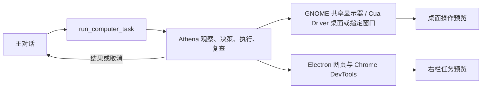

# AthenaAgent Computer Use 原型

主对话使用 `run_computer_task` 执行当前桌面或内置网页任务。桌面默认允许跨应用操作。GNOME Wayland 通过桌面门户获取共享显示器和输入权限，macOS、Windows 与 X11 使用随包的 Cua Driver，内置浏览器通过 CDP。

## Cua Driver 与 .NET 接入

Cua Driver 是 trycua/cua 的原生桌面操作驱动。它封装各平台的窗口枚举、截图、无障碍树和输入能力。上游提供 Python、TypeScript 和 MCP 等使用方式，也发布可直接集成的 C ABI。原型固定使用 **0.58.1**，以发布版的 `cua_driver_abi.h` 为接口依据。不同操作系统、窗口系统和目标应用的输入与叠层能力见上游平台说明。[0.58.1 发布页](https://github.com/trycua/cua/releases/tag/cua-driver-rs-v0.58.1) · [固定版本 C ABI](https://github.com/trycua/cua/blob/cua-driver-rs-v0.58.1/libs/cua-driver/rust/include/cua_driver_abi.h) · [平台支持](https://cua.ai/docs/cua-driver/concepts/platform-support)

Athena 以 C ABI 调用固定版本的 Cua Driver。构建时校验发行 wheel 的 SHA-256，提取目标架构的动态库与许可证，复制到构建和发布目录。macOS、Windows 与 X11 使用主显示器画面及前台输入。用户明确选择单个窗口后，每一轮观察与输入才绑定到对应进程和窗口。[驱动接入](../Services/ComputerUse/NativeDesktopSession.cs) · [构建脚本](../Scripts/stage-cua-driver.py)

## 原型设计



- **模型与执行**。在「应用设置 → 内置浏览器 → 网页任务」或「供应商与模型 → 业务模型分工」选择和测试 Computer Use 视觉模型。两处编辑同一角色，桌面和网页共用。每轮把当前画面和可见控件交给模型，网页观察还带有当前地址。能力未知时用合成图验证模型能读图并返回动作。
- **动作输出**。供应商支持结构化输出时，网页规划器用 JSON Schema 指定动作和字段类型。解析时按当前动作检查字段，控件编号 `"[7]"` 和坐标 `"24.5"` 等可明确还原的写法可以使用。控件必须来自当前观察，坐标必须处于截图内。正文为空、输出截断或动作必需字段有误时，按「无效动作重试次数」使用同一张截图再请求模型，提示需要改正的字段并提高输出额度。每次决策可重试 0–3 次，默认 1 次。官方 DeepSeek Responses 重试时还会关闭推理。达到重试上限时，工具将具体原因返回主对话。
- **网页文字输入**。`type_text` 先点中可编辑控件，再通过 Chrome DevTools 逐字发送带文字的按下与释放事件。短文本在右栏有逐字出现的间隔。由多个 Unicode 码点组合成的字符及换行等控制字符按原样插入。网页出现自动补全候选时，规划器会先观察并选择匹配项，再移动焦点。[Chrome DevTools Input](https://github.com/ChromeDevTools/devtools-protocol/blob/master/pdl/domains/Input.pdl)
- **网页横向滚动**。每轮截图覆盖当前视口。整页存在横向溢出时，观察会提供还可以滚动的方向。模型用 `scroll` 的 `left` 或 `right` 横向滚动，可指定截图中表格或轮播内的坐标。每次横移取滚动区域可见宽度的约 80%，下一次截图保留一段重叠，便于连续阅读和定位。滚动后按新截图上的坐标操作。
- **浏览器与右栏**。发布包包含固定版本的 Electron 运行时。首次打开从本地包校验并解包，Athena 通过父子进程管道调用 DevTools。「浏览」和「任务」有各自的页签，共用 Athena 的持久 Cookie 和站点存储。历史写入本机用户数据目录。当前可见页签由 Chromium 合成器在页面变化时推送原始像素，更新上限为 60 FPS。右栏按窗口的 DPI 分配位图，浏览器按 CSS 视口布局和接收输入。界面跟不上时，运行时保留最新一帧。关闭右栏会暂停预览绘制，网页任务使用上一次有效视口继续。页面尺寸发生变化时，界面收到匹配的新帧后恢复鼠标定位。Avalonia 在网页原生弹层上方绘制 Athena 光标、点击波纹和输入提示。模型在每轮观察时通过 DevTools 获取对应视口的 PNG。[Electron 离屏渲染](https://www.electronjs.org/docs/latest/tutorial/offscreen-rendering)
- **网页打开的新页签**。Electron 45.5.0 的首个渲染视图可能保留初始化时的空绘制回调，DOM 和媒体仍可运行。可见子页签等待 `paint` 150 毫秒后改用同一页面的合成帧订阅，订阅上限为 30 FPS。切走时停止订阅，下一次主导航提交后重新尝试常规绘制。回归测试检查高 DPI 下的首帧、同页更新和切回后的页面状态。[Electron 渲染视图](https://github.com/electron/electron/blob/v45.5.0/shell/browser/osr/osr_web_contents_view.cc) · [合成帧订阅](https://github.com/electron/electron/blob/v45.5.0/shell/browser/api/frame_subscriber.cc)
- **目标选择**。仅传 `instruction` 即可操作当前桌面。显式传 `target="desktop"` 始终控制整块显示器。若用户在预览中限定了窗口，省略目标时遵循该选择。`startingUrl` 启动 HTTP(S) 网页任务，`target="browser"` 可沿用右栏当前页面。[工具入口](../Services/Functions/ComputerUseFunctions.cs)
- **结果与停止**。任务通过主对话工具调用进入原有审批流程。网页任务开始时读取时限和重试次数，最长运行时间可设为 1–60 分钟，默认 3 分钟。用户直接滚动、点击、输入或切换任务标签时，任务继续运行，右栏短暂提醒用户操作可能影响结果。手动输入和模型动作依次送给浏览器。手动操作使未执行的模型决定过期，Agent 自动重新观察。用户点「接管」时显式暂停，也可以由 Agent 交回控制权。暂停期间停止发送新观察并暂停计时。点击「继续」重新观察，点击聊天「停止」结束任务。
- **网站权限**。自动执行期间出现的新权限请求立即收到拒绝结果，右栏提示用户可在接管后重试。已有站点授权仍由浏览器的权限检查处理。手动浏览或暂停时，新请求由用户确认。登录、文件选择和需要回答的网页对话继续交给用户。

## 使用与复现

### 桌面操作

GNOME Wayland 使用系统的 RemoteDesktop 和 ScreenCast 门户，在同一会话取得键鼠与显示器流。PipeWire、GStreamer 的 pipewire、videoconvert、videoscale、videorate、jpegenc 和 appsink 组件需可用。在源代码环境运行单窗口表单演示可执行以下命令。

```bash
bash Scripts/run-computer-use-demo.sh
```

演示在独立进程的表单中输入中文并点击确认，通过目标进程回报校验结果。日志记录 `Computer Use demo verified: true` 表示表单确认成功。[演示脚本](../Scripts/run-computer-use-demo.sh)

正常启动或执行 `dotnet run --project Athena.UI.csproj` 后，直接在主对话下达跨应用任务。在「桌面操作」可以预览并停止输入。系统拒绝共享、停止共享、工具取消和任务结束都会关闭桌面会话。[GNOME 接入](../Services/ComputerUse/PortalDesktopSession.cs) · [XDG RemoteDesktop](https://flatpak.github.io/xdg-desktop-portal/docs/doc-org.freedesktop.portal.RemoteDesktop.html)

当前桌面任务在系统前台应用上显示带「Athena」标签的青色箭头。桌面预览和网页任务共用箭头、移动动画、点击波纹和输入提示的绘制逻辑。独立光标窗口允许点击穿透，键盘焦点仍在被操作的应用。Athena 取桌面观察帧时临时隐藏该窗口，任务完成、取消或失败后关闭它。桌面任务的实际键鼠操作由系统前台会话接收。[光标绘制](../Controls/ComputerUseCursorDrawing.cs) · [桌面显示](../Controls/DesktopCursorDisplay.cs)

GNOME 的 RemoteDesktop v2 支持记住选择。首次共享显示器时保留系统对话框中的记住选项，之后 Athena 在每个新任务开始时向系统恢复此前批准的显示器和键鼠权限。任务之间屏幕共享处于关闭状态。恢复凭据按用户保存在本机状态目录，每次使用后保存系统返回的新凭据。用户撤销授权、显示器无法恢复或使用旧版门户时，系统会再次询问。[门户会话持久化](https://flatpak.github.io/xdg-desktop-portal/docs/doc-org.freedesktop.portal.RemoteDesktop.html#session-persistence)

在 Wayland 桌面会话中，`type_text` 若带有屏幕坐标会先点击目标输入框并等待焦点稳定，随后通过 `org.freedesktop.portal.Clipboard` 写入 UTF-8 剪贴板并发送 `Ctrl+V` 粘贴（支持暂存并恢复原有纯文本剪贴板），绕过 IBus/Rime 等输入法组合并兼容原生 Wayland 与 XWayland 应用；若没有控件读取剪贴板，会明确回报给规划器。不支持剪贴板门户的旧环境继续使用门户键位事件。快捷键和切换窗口均通过门户发送。[剪贴板粘贴实现](../Services/ComputerUse/PortalClipboard.cs) · [GNOME 接入](../Services/ComputerUse/PortalDesktopSession.cs)

### 内置浏览器与网页任务

正式包自带浏览器运行时。普通浏览可点击聊天链接或打开右栏地球入口。模型角色中的图标可测试连接与能力，绿色数字是完整测试耗时。起始页、下载目录与资料清理由「应用设置 → 内置浏览器」管理。浏览资料保存在操作系统的 AthenaAgent 用户数据目录下，持久 Cookie 的过期与注销遵循网站规则。下面这条指令可用于验证跨站导航。

> 用 Computer Use 从 https://example.org/ 开始。点击地址栏，输入 https://www.iana.org/help/example-domains 并回车。打开后读取网页标题，在对话里告诉我。

「任务」页会显示实际打开的网址与网页。要结束正在运行的任务，点击聊天输入框右侧的「停止」。

发布脚本按 RID 读取锁定的 Electron 版本和 SHA-256，将校验后的原始压缩包放入 `BrowserRuntime/runtime.zip`。安装包、应用内更新包和本地调试可使用相同的准备脚本。首次打开浏览器时，从随包资源解包到用户目录中的版本化缓存，浏览资料位于独立的资料目录。更新替换安装目录中的运行时包时，会继续使用现有浏览资料。

`dotnet build -c Release` 会用 Python 3 将目标平台的 Electron 包放入应用输出目录的 `BrowserRuntime/runtime.zip`。首次构建需要下载，后续构建复用通过 SHA-256 校验的文件。运行时准备失败会使 Release 构建报错。构建成功后可直接启动输出目录中的 Athena。

源码调试使用 `dotnet run --project Athena.UI.csproj` 或 VS Code 的 `Debug Athena.UI`，启动前会调用同一准备脚本。若直接运行本地 Debug 产物，可先将运行时准备到对应的输出目录。Apple Silicon 上的原生 .NET 使用 `osx-arm64`，Intel Mac 或 Rosetta 下运行的 x64 .NET 使用 `osx-x64`。

```bash
python3 Scripts/stage-browser-runtime.py osx-arm64 bin/Debug/net10.0
```

### macOS 共享纹理原型

源码构建可以显式开启 IOSurface 预览。需要 Xcode 命令行工具和带 Node-API 头文件的 Node.js。`ATHENA_NODE_HEADERS` 可以指向头文件目录。

```bash
bash Scripts/build-browser-gpu-macos.sh
ATHENA_BROWSER_GPU_DIRECTORY="$PWD/obj/browser-gpu" dotnet run --project Athena.UI.csproj
```

开启后，Avalonia 优先使用 Metal。Electron 主进程经 Mach 端口送出 IOSurface，接收端验证 Electron 进程身份。Athena 在 GPU 上复制到独立纹理，以便 Chromium 安全复用原有帧池，再由 Avalonia 合成线程绘制新纹理。浏览和任务沿用同一个 Chromium 资料目录、CDP、输入坐标和 Athena 光标叠层。运行环境缺少互操作能力或未收到纹理时，预览回退到位图。捕获帧的像素尺寸保持不变时，`Page.frameResized` 仍可触发 CSS 视口校验。原型显示页面主表面，Chromium 单独输出的原生子弹层尚未接入共享纹理合成。

性能测试使用真实的 Avalonia 窗口和同一个临时 Chromium 资料目录。脚本需要 FFmpeg，生成本地的 60 FPS 视频并与连续滚动一起测试。两轮以相反顺序运行，比较 OpenGL 位图、Metal 位图和 Metal IOSurface。统计量是有新预览内容的 Avalonia 动画帧频率与间隔，CPU 为 Athena 进程独占的单核百分比。测试也会在切换渲染路径后读取原有 Cookie 和站点存储，并对一个网页任务执行显式接管与恢复。

```bash
python3 Scripts/benchmark-browser-preview.py
```

2026-11-27 在 Apple M4 上使用真实的 2× 窗口，网页像素尺寸为 1076 × 1336。每个场景预热 2 秒，测量 8 秒，两轮取中位数。长帧为两次新画面节拍间隔超过 25 毫秒。

| 路径 | 场景 | FPS | p95 帧间隔（ms） | 长帧（%） | Athena CPU（% 单核） |
| --- | --- | ---: | ---: | ---: | ---: |
| OpenGL 位图 | 滚动 | 60.0 | 17.1 | 0.1 | 41.5 |
| OpenGL 位图 | 视频 | 59.9 | 18.6 | 0.1 | 38.2 |
| Metal 位图 | 滚动 | 59.9 | 17.3 | 0.1 | 31.8 |
| Metal 位图 | 视频 | 60.0 | 17.2 | 0.0 | 28.0 |
| Metal IOSurface | 滚动 | 58.3 | 17.5 | 1.4 | 26.2 |
| Metal IOSurface | 视频 | 59.5 | 17.5 | 0.4 | 22.4 |

同为 Metal 时，共享纹理分别减少约 18% 和 20% 的 Athena CPU 用量。两轮共享纹理均验证了同一资料目录的 Cookie 和站点存储，并用本地网页验证了接管与恢复。[跑分脚本](../Scripts/benchmark-browser-preview.py)

接上 CSS 视口变化事件后，浏览器专项在默认路径和实验模式的位图回退上均通过。共享纹理单次补测录得滚动 59.0 FPS、视频 60.0 FPS，仍使用相同的 1076 × 1336 视口。

### Linux 共享纹理原型

Linux 源码版可用同一个环境变量开启 DMA-BUF 预览。Fedora 构建需要 C 编译器、pkg-config、Node-API 头文件、`libglvnd-devel` 和 `libdrm-devel`。如果 Node.js 的安装目录没有头文件，请将 `ATHENA_NODE_HEADERS` 指向包含 `node_api.h` 的目录。

```bash
bash Scripts/build-browser-gpu-linux.sh
ATHENA_BROWSER_GPU_DIRECTORY="$PWD/obj/browser-gpu" dotnet run --project Athena.UI.csproj
```

Electron 主进程通过 Unix 域套接字传递 DMA-BUF 文件描述符。Athena 核对发送进程、用户和帧序号，按每个平面的偏移、步长及 DRM modifier 导入 EGL。Avalonia 的 Skia 渲染线程在 GPU 上复制一份可重复绘制的纹理，完成栅栏确认复制结束后才允许 Chromium 复用原帧。传输中的纹理数量有上限，渲染较慢时保留最新帧。原型支持 BGRA 网页主表面。[Electron 的共享纹理句柄](https://www.electronjs.org/docs/latest/api/structures/shared-texture-handle) · [EGL DMA-BUF 导入](https://registry.khronos.org/EGL/extensions/EXT/EGL_EXT_image_dma_buf_import.txt)

开启原型时，Linux 的 Avalonia X11 后端优先选 EGL，在 GNOME Wayland 下通过 XWayland 显示。缺少桥接库时直接用常规位图。EGL 导入失败、软件渲染或 Chromium 的 GPU 进程退出时，已打开的网页可切到位图，继续使用原页签、登录状态和输入通道。取消环境变量即可使用默认预览。

下面的对照测试需要 FFmpeg 和持续刷新的显示器。脚本在同一个临时浏览资料目录测试滚动、60 FPS 视频和任务接管，并在实际窗口采样红蓝色块，检查通道和上下方向。

```bash
python3 Scripts/benchmark-browser-preview.py
python3 Scripts/benchmark-browser-preview.py --skip-build --trials 1 --mode bitmap-fallback --mode dmabuf-loss
```

2026-11-27 在 Fedora 45、Intel Arrow Lake-P 核显（i915，Mesa 26.2.7）上实测。使用独立 Mutter 60 Hz 虚拟显示器、XWayland 和真实 GPU，2× 网页预览为 1076 × 1336 像素。每个场景预热 2 秒、测量 8 秒，两轮按相反顺序运行并取中位数。FPS 统计窗口呈现新预览内容的动画节拍。CPU 以一个逻辑核心为 100%，进程树包括 Athena、Electron 渲染器和 GPU 进程。锁屏时物理桌面的窗口时钟被限到约 1 Hz，此组数据已排除。

| 路径 | 场景 | FPS | p95 帧间隔（ms） | Athena CPU | Athena + Electron CPU |
| --- | --- | ---: | ---: | ---: | ---: |
| 默认位图 | 连续滚动 | 59.9 | 25.4 | 56.8% | 139.4% |
| 默认位图 | 60 FPS 视频 | 60.0 | 22.9 | 57.9% | 135.1% |
| EGL 位图 | 连续滚动 | 59.5 | 24.4 | 58.0% | 143.3% |
| EGL 位图 | 60 FPS 视频 | 59.8 | 24.1 | 55.9% | 135.8% |
| DMA-BUF / EGL | 连续滚动 | 56.6 | 30.9 | 8.3% | 22.4% |
| DMA-BUF / EGL | 60 FPS 视频 | 56.5 | 31.8 | 7.7% | 21.9% |

相对默认位图，滚动与视频的进程树 CPU 均降低约 84%，显示帧率分别下降 3.3 和 3.5 FPS。两轮计时区间收到的共享纹理帧占比均为 100%。故障测试分别隐藏 `/dev/dri` 并让 Mesa 使用软件渲染，以及在共享纹理已经显示时通过 CDP 结束测试浏览器的 GPU 进程。两种情况下均核对了原页签的实际像素、后续滚动和视频位图帧，以及网页任务的接管和恢复。缺少 OpenGL 的 Avalonia 渲染器在订阅前就选择位图，静态页签重选也能显示首帧。[跑分脚本](../Scripts/benchmark-browser-preview.py)

### Fedora 高刷新率与 TestUFO 实测

此前每个 Electron 离屏标签页都设置为 60 FPS。Linux 共享纹理预览现在按 Athena 窗口所在显示器的 XRandR 活动模式设置帧率，移窗和显示模式变化会更新上限。此机在 GNOME Wayland 下，Electron 报告的 `displayFrequency` 为 0，XWayland 查询内屏得到 164.98 Hz。无法取得刷新率时使用 60 FPS。位图预览以 60 FPS 为上限，GPU 在运行中失效后也恢复这个上限。[Electron 离屏渲染实现](https://github.com/electron/electron/blob/v45.5.0/shell/browser/osr/osr_render_widget_host_view.cc)

以下命令在真实 Avalonia 窗口中打开在线 TestUFO 首页，保留默认的三架 UFO、星空背景和 960 像素/秒。等待网页出现帧率并预热后，每秒读取网页的 Frame Rate、Refresh Rate 和同步状态，同时统计 8 秒内有新预览画面的窗口动画节拍。该窗口指标反映 Athena 提交给窗口的画面，物理面板逐帧扫描输出需另外测量。[TestUFO](https://testufo.com/)

```bash
python3 Scripts/benchmark-browser-preview.py --testufo --trials 2 --mode bitmap-default --mode dmabuf-egl
```

2026-11-27 使用 Fedora 45 的 3072 × 1920、165 Hz 实体内屏，Athena 预览为 1076 × 1336 像素。Chrome 的 10 次页面读数中有 9 次为 165 FPS、1 次为 160 FPS。Codex Desktop 的 8 次读数为 102–106 FPS，TestUFO 最终提示垂直同步失败。Athena 的两种路径在修复前各测一轮，修复后交换顺序各测两轮。

| Athena 路径 | TestUFO 网页 FPS | 右栏新画面 FPS | Athena 与 Electron 进程树 CPU |
| --- | ---: | ---: | ---: |
| 修复前，位图 | 60 | 60.0 | 140% |
| 修复前，共享纹理 | 60 | 59.5 | 24.9% |
| 修复后，位图 | 60 | 60.1、60.0 | 138.2%、143.1% |
| 修复后，共享纹理 | 165 | 140.0、143.6 | 57.9%、50.7% |

修复后共享纹理的 16 次页面采样全部显示 165 FPS、165 Hz 和 `READY*`。右栏帧间隔 p95 为 17.8 毫秒（两轮中位数），进程树 CPU 比默认位图低约 61%。单独尝试让位图也按 165 Hz 运行时，网页显示 165 FPS，右栏只收到 24.2–25.5 FPS。这是保留位图上限的实测依据。

在隔离进程中屏蔽 `/dev/dri` 并强制 Mesa 软件渲染后，同一测试页显示 60 FPS，8 秒内右栏提交了 480 帧，全部为位图。共享帧率在浏览器实际交付可用纹理时才提高。另一次在正常纹理已经显示后结束 Electron GPU 进程，原页签切换到位图订阅，TestUFO 显示 60 FPS，右栏为 30.1 FPS，8 秒内收到的 241 帧全部为位图。

另在 60 Hz 的独立 Mutter 虚拟显示器复核了显示器选择逻辑。TestUFO 的 8 次读数均为 60 FPS，同尺寸右栏测得 56.0 FPS，448 帧全部使用共享纹理。

### Windows 验证范围

在这台 Fedora 主机上已交叉构建 `win-x64` 的 Athena.UI 托管程序。Windows 共享纹理需要把 Electron 主进程中的 NT 句柄复制到 Athena 进程，再用 D3D11 打开纹理。显示、驱动同步、设备丢失后的回退和性能需要在配有 GPU 的 Windows 环境中验收。[Electron 共享句柄](https://www.electronjs.org/docs/latest/api/structures/shared-texture-handle) · [D3D11 打开共享资源](https://learn.microsoft.com/en-us/windows/win32/api/d3d11_1/nf-d3d11_1-id3d11device1-opensharedresource1)

### 回归测试

从仓库根目录构建 Release，再让浏览器专项测试使用该构建携带的 Electron。

```bash
dotnet build -c Release
ATHENA_HEADLESS_ONLY=computer-use ATHENA_BROWSER_SMOKE=1 \
  ATHENA_BROWSER_RUNTIME_DIRECTORY="$PWD/bin/Release/net10.0/BrowserRuntime" \
  bash Scripts/run-headless-tests.sh /tmp/athena-computer-use.png
bash Scripts/run-headless-tests.sh /tmp/athena-main-window.png
```

## 验证记录

本轮提交前验证环境为 Fedora Linux 45 x64、.NET SDK 10.0.113、Chrome 156.0.8078.79。Cua Driver 桌面演示记录使用 0.58.1。同一测试环境的 X11 虚拟桌面叠层试验与原型的应用内预览分别验收。

| 项目 | 实测结果 |
| --- | --- |
| GNOME Wayland 跨应用与授权恢复，2026-11-27 | Fedora 45、内屏 3072 × 1920、150% 缩放。主工具 `run_computer_task` 只接收任务说明，MiniMax-M3.1-Flash 点击 GNOME 计算器等号读得 845，再点击文本编辑器，在第二行输入 `GNOME result = 845` 并用 Ctrl+S 保存。独立读取文件确认标题与结果行均正确。关闭共享后新建连接，654 毫秒重新取得 1440 × 900 的授权显示器帧，系统直接复用首次选择。 |
| GNOME 桌面虚拟光标，2026-11-27 | 在本机 GNOME Wayland、150% 缩放和原生 GTK 文本窗口上，通过独立显示器画面验证了 Athena 箭头、点击波纹与输入标签。窗口收到实际点击和指定文字，并持续持有焦点。两张供规划器使用的观察图和任务结束后的桌面局部均无光标或标签。 |
| 桌面光标清理，2026-11-27 | 在只有一块显示器、未指定主屏的隔离 X11 会话中，分别停止任务和触发规划错误。两次都先观察到光标窗口出现，任务返回后确认光标窗口已消失。 |
| GNOME 指针实际落点，2026-11-27 | 对共享屏幕右部和右下部的两个位置做只移动指针的实测。在 1440 × 900 的观察图上，请求 (1010, 258) 和 (1260, 675)，独立读回 (1009.69, 257.70) 和 (1260, 675)。整条输入链路的两个落点误差均小于一个观察图像素。 |
| 桌面坐标定位，2026-11-27 | 在同一张 1440 × 900 的隔离桌面截图上，让 MiniMax-M3.1-Flash 分别定位 GNOME 计算器的数字 7 和等号，以及 GNOME 文本编辑器的主菜单和正文。每个目标独立请求两次，8 个坐标均在预先确定的控件边界内。34 × 35 像素的主菜单按钮两次落点距中心约 3–4 像素。此项只衡量指定控件的静态定位。 |
| Cua Driver 桌面表单，2026-11-25 | 驱动找到独立表单，录入中文并点击确认。目标窗口回报内容与预期一致。 |
| 系统级光标叠层，2026-11-25 | 隔离 X11 桌面截图捕捉到上游 Cua Driver 光标。GNOME Wayland 的系统级叠层未验收。当时的 Athena 只在应用内预览绘制光标。 |
| 窗口缩窄与多页任务，早期浏览器原型 | 英文 Wikipedia 的测试将实际视口从 1176 × 786 缩到 546 × 601，页面重排后仍完成了站内搜索并核对 Ada Lovelace 条目。另一次长任务依次访问 Ada Lovelace、Charles Babbage、Difference engine 与 Analytical engine，约 100 秒；早期尝试也有中途结束的记录。 |
| 12306 未登录查询，早期浏览器原型 | 测试脚本查询 2026-11-25 广州至苏州，核对了登录入口、日期和查询请求。当时页面显示 0 条直达结果。采集后约 186 毫秒退出该次测试的浏览器会话，并核查临时配置已删除。 |
| 官方 DeepSeek Flash 与真实网页 | 从 Example Domain 页面开始，执行地址栏导航，浏览器确实到达 IANA。工具返回成功，主模型接着回复了目的页标题 “Example Domains”。[IANA 测试目的页](https://www.iana.org/help/example-domains) |
| 早期原型的浏览器回归 | 验证聊天链接路由、网页链接和前进后退、拒绝非网页导航。窗口宽高变化后，「浏览」和「任务」两页都填满页面区域。任务视口从 468 × 685 调整为 358 × 925，旧坐标被作废，模型的新截图包含下方提交按钮。关掉右栏后真实 Chrome 仍提交了表单，下一次主模型请求带有匹配的工具结果。点击聊天停止按钮能取消正在等待的网页决策，主对话留下配对的中断结果。 |
| 网页动作解析，2026-11-26 | 专项测试注入了输出截断、空正文及非数字 `element`，三次均在同一观察上各重试一次并恢复，拆成多个文本片段的动作也能读取。另用真实 Chrome 和官方 `deepseek-flash` 在 358 × 925 和 468 × 685 两种视口填表和提交，两轮都读回了与服务端一致的回执。在 12306 公开查询页只读识别控件时，模型有一次返回不完整的动作，重试后识别成功。 |
| 网页自动补全，2026-11-26 | 旧的文本插入在 12306 输入「苏州」时未生成候选或站点码。改用逐字键盘事件后，出现「苏州北」「苏州」「苏州南」等候选。官方 `deepseek-flash` 在 468 × 850 视口选中「苏州」并转移焦点，页面仍保留站点码 `SZH`。本地 Chrome 回归覆盖逐字事件、候选选择、失焦保留和表单提交。 |
| 随包运行时和共享资料，2026-11-26 | Linux x64 从发布包提取 Electron 45.5.0，并在仅有回环网络、系统 Chrome 不可见的环境验收本地站点。浏览与任务共享同一登录，Cookie、站点存储和历史跨运行时重启及安装位置变更保留。验证上传、下载、对话框、权限与接管后重新观察。官方 DeepSeek 在 12306 完成真实视觉测试和选站，失焦后保留 `SZH`。 |
| 提交前复验，2026-11-26 | 浏览器专项测试与完整 Avalonia 无头测试通过。构建为 0 警告、0 错误。 |
| 网页原生弹层，2026-11-26 | 在真实 MDN 中文首页点击搜索并输入 `Array.prototype.map()`。搜索候选正常出现，Avalonia 预览截图在输入点显示 Athena 光标。随包运行时回归覆盖弹层上的光标合成，以及开放 Shadow DOM 内的输入焦点。 |
| 动作字段与任务页恢复，2026-11-26 | 模拟供应商验证了未使用字段的类型错误、字符串坐标和布尔值，以及非法控件编号和不完整坐标的拒绝。随包 Electron 45.5.0 的实际视口被强制改动后，「任务」页在原页签显示新帧，任务重新观察并完成提交。换模型后的同一会话第二次任务将截图发给了新模型。另用官方 `deepseek-flash` 在 358 × 850 的本地测试页填写并提交中文，页面回显和工具结果均已验证。 |
| 网页任务设置 | 在设置界面修改视觉模型、运行时限和重试次数后重载配置，验证了两处共用的模型角色与保存值。随包 Electron 专项验证了同一观察重试两次、接管暂停计时，以及继续后到时返回明确的超时结果。 |
| 右栏清晰度和帧率，2026-11-26 | Fedora 桌面在 2× 下对同一 466 × 509 CSS 像素动画页采样实际窗口。旧版约 7.4–7.8 FPS。修改后首次短测约 23.6 FPS，两次 5 秒复测均为约 59.5 FPS。原始帧从 466 × 509 提高到 932 × 1018。随包 Electron 专项核对了物理像素位置、人工及模型点击、网页弹层上的光标、缩放后重新观察，以及收起面板继续执行并回传结果。 |

已在 Fedora 交叉构建 Windows x64 和 macOS arm64，并核验随包的 PE、Mach-O 原生驱动。Windows 与 macOS 的桌面输入仍待对应系统实机验收。
