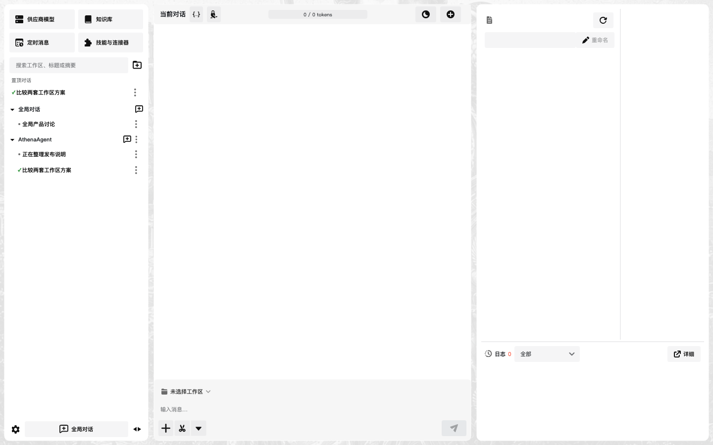
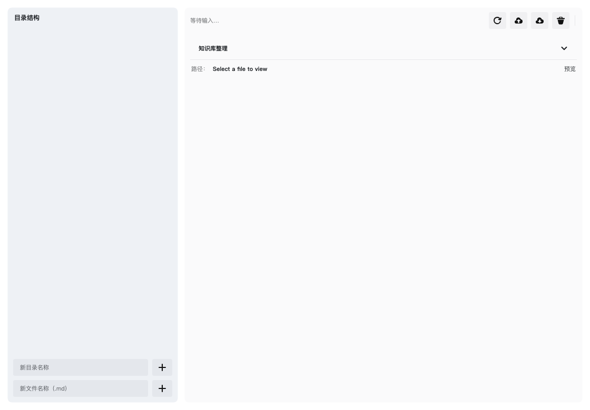
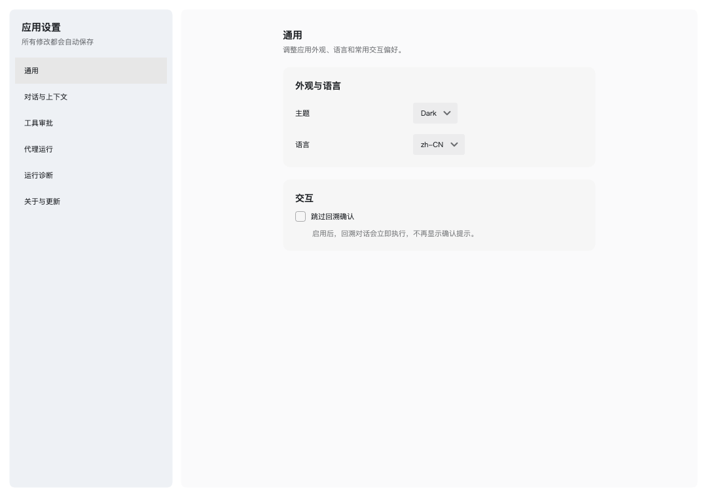
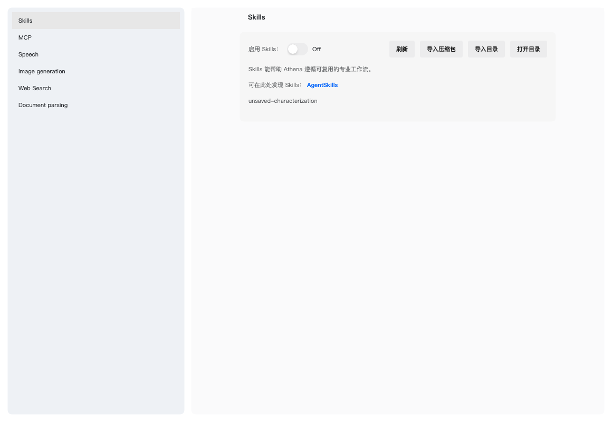

[](README_CN.md) · **English**

---

# Athena Assistant

Athena is a sophisticated, highly autonomous desktop AI assistant built with **.NET 10** and **Avalonia UI**. It serves as an intellectual partner with deep system integration, proactive capabilities, and a modern, polished interface.

## ✨ Key Features

- **🧠 Unified Provider and Model Roles**: One OpenAI SDK-compatible provider owns shared connection details; main chat, titles, compression, automatic approval, embeddings, image recognition, and sub-agents select independent models. TTS and image generation keep their own Extension connections.
- **🛠️ Direct Tool Calling**: The main conversation invokes built-in and MCP tools through one schema-validation, approval and result-budget gate; real calls remain visible in grouped, expandable cards. Main conversation and sub-agent tool rounds are unlimited.
- **🧩 Optional PTC Prototype**: Default-off, bounded in-process JavaScript orchestration of five read-only file tools, with per-call approval, child progress, immutable audit records and small model projections. Not a strong sandbox. See [PTC usage and limitations](Docs/PTC_Prototype_Usage_CN.md) and [implementation evidence](Libraries/Ptc/IMPLEMENTATION.md).
- **📊 Optional Execution Timeline**: Inspect main-model attempts, direct and PTC tool calls, script lifetime, approvals and waits in a per-reply multi-lane timeline. Disabled by default; timing metadata stays local.
- **🦉 Parallel Sub-Agents**: Fans out batches of isolated sub-agents for concurrent work, visualized as an animated "owl village" overview.
- **Built-in browser and Computer Use** open chat links and show Athena's browser cursor, clicks, and typing in the right panel. Desktop input has a separate window preview.
- **📚 Local Knowledge Base**: A vector-powered semantic memory stored locally in Markdown files with hybrid retrieval (vectors + BM25/FTS) and optional background maintenance.
- **📄 Document Parsing**: MinerU-backed extraction of outlines and content from attached documents.
- **🎨 Image Generation & Audio**: Inline image generation with cross-turn continuity, plus TTS audio playback.
- **↩️ Conversation Archive, Rewind & Fork**: Persisted, browsable sessions that can be rewound or forked into branch conversations.
- **🌿 Workspace Git branches**: Switch or create branches above the composer; inspect local and remote snapshots, upstream status and worktree occupancy. Manage branches with patch comparison, local rename and confirmed safe deletion. Checkout checks the entire repository, and branch mutations exclude live assistant turns.
- **⏰ Cron Scheduling**: Standard five-field cron tasks. Every firing opens its own brand-new session instead of interrupting the chat you are looking at, so a task can run while you keep working.
- **🌍 Modern Cross-Platform UI**: Built with Avalonia UI and the Semi Design aesthetic, supporting both light/dark modes and multi-lingual interfaces (English & Chinese).
- **🛡️ Security-First Design**: Tool calls follow approval and file-access policies. Computer Use targets a window you select.

## 🖼️ Interface Preview

| Three-pane workspace | Knowledge Base |
| --- | --- |
|  |  |
| App Settings | Skills & Connectors |
|  |  |

## 🚀 Getting Started

### Prerequisites

- [.NET 10 SDK](https://dotnet.microsoft.com/download/dotnet/10.0)

### Installation & Running

1. **Clone the repository**:
   ```bash
   git clone https://github.com/mehaifeng/AthenaAgent.git
   cd AthenaAgent
   ```

2. **Restore dependencies**:
   ```bash
   bash Libraries/Ptc/scripts/build-local-feed.sh
   dotnet restore Athena.UI.sln
   ```

3. **Run the application**:
   ```bash
   dotnet run --project Athena.UI.csproj
   ```

## 🏗️ Project Structure

- `Services/`: Core business logic, including AI integration, file system management, and task scheduling.
- `ViewModels/`: MVVM ViewModels for application state and UI logic.
- `Views/`: Avalonia XAML definitions for the user interface.
- `Models/`: Data structures, configuration schemas, and prompt templates.
- `Assets/`: Icons, localized strings, and static knowledge base files.

## 🛠️ Tech Stack

- **Framework**: Avalonia UI 12.0
- **Runtime**: .NET 10
- **UI Themes**: Semi.Avalonia, Irihi.Ursa.Themes.Semi
- **AI SDK**: OpenAI SDK 2.x (Chat, Embeddings, Image Generation, Audio/TTS, Tool Calling; shared retry and timeout policy)
- **Markdown** uses LiveMarkdown.Avalonia 2.8 for streaming text and code, inline images, RaTeX math, and native Mermaid diagrams. In General settings you can fade in newly received text or entire new lines, or turn the effect off. Native Windows ARM64 builds display formulas as TeX text.
- **Computer Use** uses the Cua Driver native SDK.
- **Audio**: Provider TTS and platform player commands
- **Database**: SQLite (for vector storage)
- **Logging**: Serilog (File + Console sinks)

## Computer Use prototype

Run `bash Scripts/run-computer-use-demo.sh` on Linux x64 to open the preview and its demo form. The scripted demonstration clicks and enters text through Cua Driver and verifies it using the target form. The script downloads the pinned SDK and checks its checksum. Set `ATHENA_CUA_DRIVER_LIBRARY` to use a local SDK library.

Pass `--app` to the same script for the normal Athena window. Open Desktop computer use from the left toolbar, select a window, and ask Athena in chat to perform the task. Desktop input uses the Image Recognition model or the main model when that role is unset.

With Chrome or Chromium installed, click a chat link or use the built-in browser button in the conversation header. Web links open in the right panel's Browse tab. Right-click a chat link to open it in the system browser.

Describe the website and task in the main conversation. Browser Computer Use runs through `run_computer_task` with the configured official DeepSeek credentials for `deepseek-flash`. It can navigate directly to an address as instructed. The Task tab shows the current address, page, cursor, and status. Browse and Task use separate temporary sessions. Closing or collapsing the pane pauses the preview. Completed results return to the main model for a reply. Use Stop next to the chat input to cancel the task and reply.

[Prototype design, Cua Driver integration, and test results (Chinese)](Docs/ComputerUse_Prototype_CN.md)

## 📄 License

This README records MIT as the project license. The PTC packages ship their own [license file](Libraries/Ptc/LICENSE) and [notices](Libraries/Ptc/ThirdPartyNotices.md).
