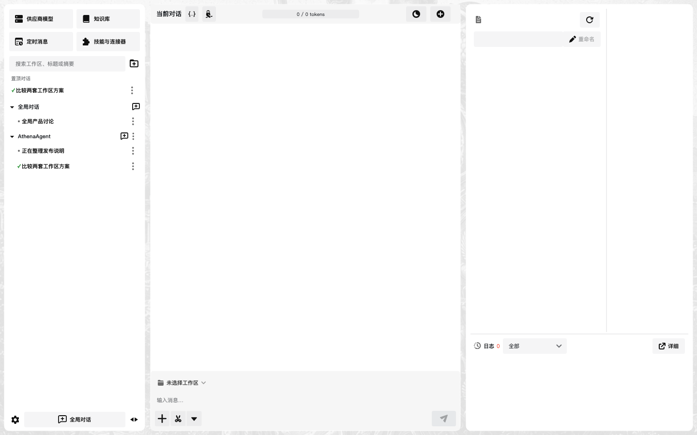
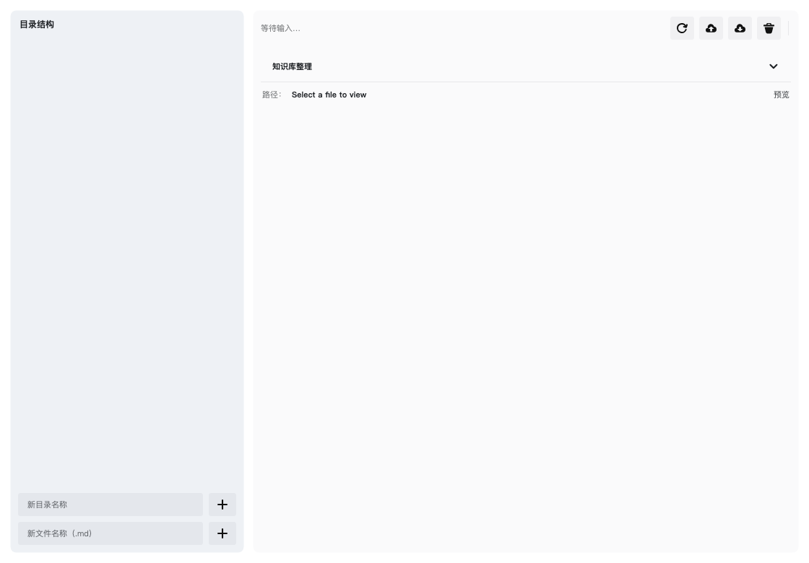
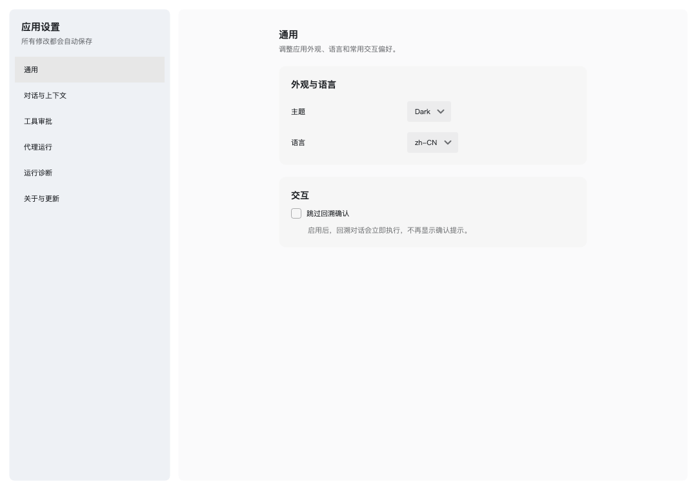
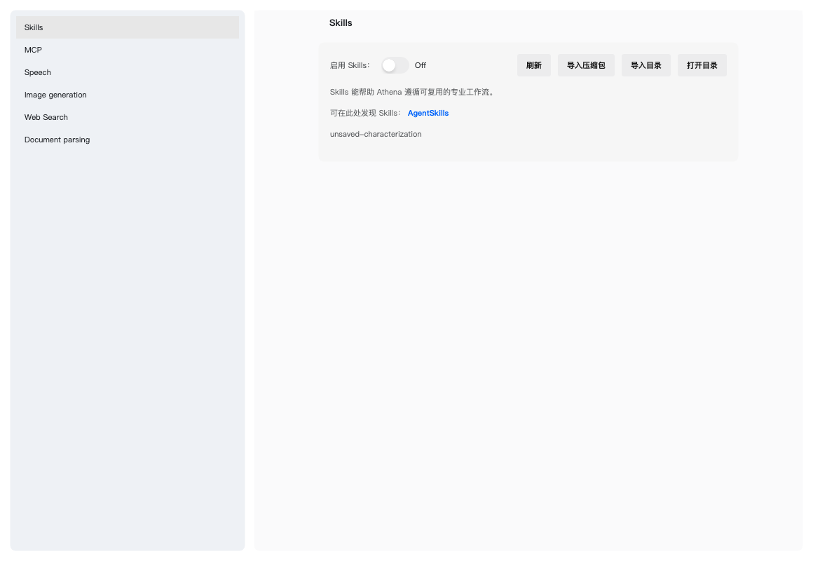

[](README.md) · **中文**

---

# Athena 智能助手

Athena 是一款高度自主的桌面 AI 助手，基于 **.NET 10** 和 **Avalonia UI** 构建。它不仅是你的智能伙伴，更具备深度系统集成能力、主动服务机制和现代化的用户界面。

## ✨ 核心特性

- **🧠 唯一供应商与模型分工**：唯一的 OpenAI SDK 兼容供应商统一保存连接信息；主对话、标题、上下文压缩、自动审批、Embedding、浏览器与子代理分别选择模型。TTS 与生图保留扩展页独立连接。
- **🛠️ 直接工具调用**：主对话直接调用内置工具与 MCP，统一经过 Schema 校验、审批和结果预算闸门；实际调用仍以可展开的分组卡片呈现。 主对话与子代理的工具调用轮数不设上限。
- **🧩 可选 PTC 原型**：默认关闭的、有预算限制的进程内 JavaScript 编排，仅开放五个只读文件工具，保留逐项审批、子调用进度、不可变审计记录和小体量模型投影。不是强沙箱。见[使用与限制](Docs/PTC_Prototype_Usage_CN.md)及[实施证据](Libraries/Ptc/IMPLEMENTATION.md)。
- **📊 可选执行时间线**：在每条助手回复中查看主模型调用、直接及 PTC 工具调用、脚本生命周期、审批和等待。默认关闭，时间元数据仅存本地。
- **🦉 并行子代理**：批量派发相互隔离的子代理并发处理任务，以动画化的"猫头鹰之城"总览呈现进度。
- **内置浏览器和 Computer Use** 在右侧工具区打开对话里的网页，并实时显示 Athena 在网页上的光标、点击和录入。桌面操作有独立的窗口预览。
- **📚 本地知识库**：基于向量检索的语义记忆系统，以 Markdown 格式本地存储，支持混合检索（向量 + BM25/FTS）与可选后台维护。
- **📄 文档解析**：基于 MinerU 从附件文档中提取大纲与正文内容。
- **🎨 图像生成与语音**：支持跨轮次连贯的内联图像生成，以及 TTS 语音播放。
- **↩️ 会话归档、回滚与分支**：会话持久化且可浏览，任意轮次均可回滚或分支为新的分支会话。
- **🌿 工作区 Git 分支**：在输入区上方切换或新建分支，查看本地与远程快照、跟踪状态和工作树占用；管理窗口支持比较差异、重命名与确认删除已合入的本地分支。切换前检查整个仓库的未提交改动，运行中的助手会话与分支变更互斥。
- **⏰ cron 定时任务**：标准五段 cron 调度。每次触发都会开出一个全新会话，而不是往你正在看的对话里插消息，因此任务可以在你继续工作的同时跑。
- **🌍 现代跨平台界面**：基于 Avalonia UI 和 Semi Design，支持浅色/深色模式及多语言界面（英文 & 中文）。
- **🛡️ 安全优先设计**：工具调用遵守审批和文件访问规则，浏览器任务使用隔离会话。

## 🖼️ 界面预览

| 三栏工作区 | 知识库 |
| --- | --- |
|  |  |
| 应用设置 | Skills 与连接器 |
|  |  |

## 🚀 快速开始

### 环境要求

- [.NET 10 SDK](https://dotnet.microsoft.com/download/dotnet/10.0)

### 安装与运行

1. **克隆仓库**：
   ```bash
   git clone https://github.com/mehaifeng/AthenaAgent.git
   cd AthenaAgent
   ```

2. **还原依赖**：
   ```bash
   bash Libraries/Ptc/scripts/build-local-feed.sh
   dotnet restore Athena.UI.sln
   ```

3. **运行应用**：
   ```bash
   dotnet run --project Athena.UI.csproj
   ```

## 🏗️ 项目结构

- `Services/`：核心业务逻辑，包括 AI 集成、文件系统管理和 cron 定时任务（`Services/Cron/`）。
- `ViewModels/`：MVVM ViewModel，负责应用状态和 UI 逻辑。
- `Views/`：Avalonia XAML 界面定义。
- `Models/`：数据结构、配置模型和提示词模板。
- `Assets/`：图标、本地化字符串和静态知识库文件。

## 🛠️ 技术栈

- **框架**：Avalonia UI 12.0
- **运行时**：.NET 10
- **UI 主题**：Semi.Avalonia、Irihi.Ursa.Themes.Semi
- **AI SDK**：OpenAI SDK 2.x（对话、嵌入、图像生成、Audio/TTS、工具调用；统一重试与超时策略）
- **Markdown** 使用 LiveMarkdown.Avalonia 2.8 渲染流式正文和代码、内联图片、RaTeX 公式及原生 Mermaid 图表。在「设置 → 通用」可以选择「新增文字淡入」「按行淡入」或「关闭」。Windows ARM64 原生版本以 TeX 文本显示公式。
- **Computer Use** 使用 Cua Driver 原生 SDK。
- **音频**：供应商语音合成和平台播放器命令
- **数据库**：SQLite（向量存储）
- **日志**：Serilog（文件 + 控制台）

## Computer Use 原型

Linux x64 下执行 `bash Scripts/run-computer-use-demo.sh`，会打开操作预览和独立演示表单。演示通过 Cua Driver 录入中文、点击确认，并核验表单结果。脚本下载固定版本的 SDK 并检查哈希，已有 SDK 也可用 `ATHENA_CUA_DRIVER_LIBRARY` 指定库路径。

同一脚本加 `--app` 可启动完整 Athena。从左侧「桌面操作」选择要操作的窗口，再在聊天中说明任务。桌面任务使用「图片识别」模型，未配置时使用主对话模型。

安装 Chrome 或 Chromium 后，点击对话里的网页链接，或点击对话标题栏的「内置浏览器」按钮。网页默认在右侧「浏览」页打开。右键点击对话链接可选择用系统浏览器打开。

在主对话中说明要访问的网址和任务。Athena 通过 `run_computer_task` 调用配置中的官方 `deepseek-flash`，可按指令直接从地址栏导航到指定网址。右侧「任务」页实时显示当前网址、页面、光标与状态。浏览和任务使用独立的临时会话。关闭面板或收起右栏后任务继续执行，完成后结果返回主对话，由主模型继续作答。点击聊天输入框右侧的「停止」可结束当前任务和回复。

[原型设计、Cua Driver 接入与测试记录](Docs/ComputerUse_Prototype_CN.md)

## 📄 开源协议

本 README 记录的项目许可证为 MIT。PTC 包随包提供该模块的[许可文件](Libraries/Ptc/LICENSE)和[第三方声明](Libraries/Ptc/ThirdPartyNotices.md)。
